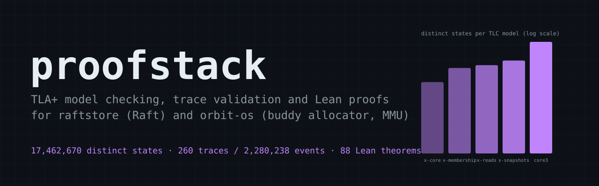
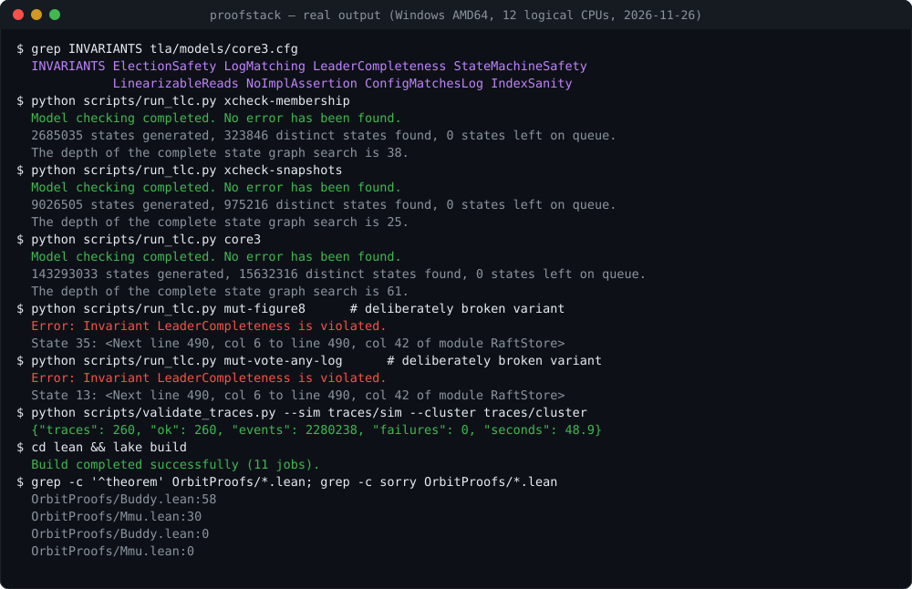
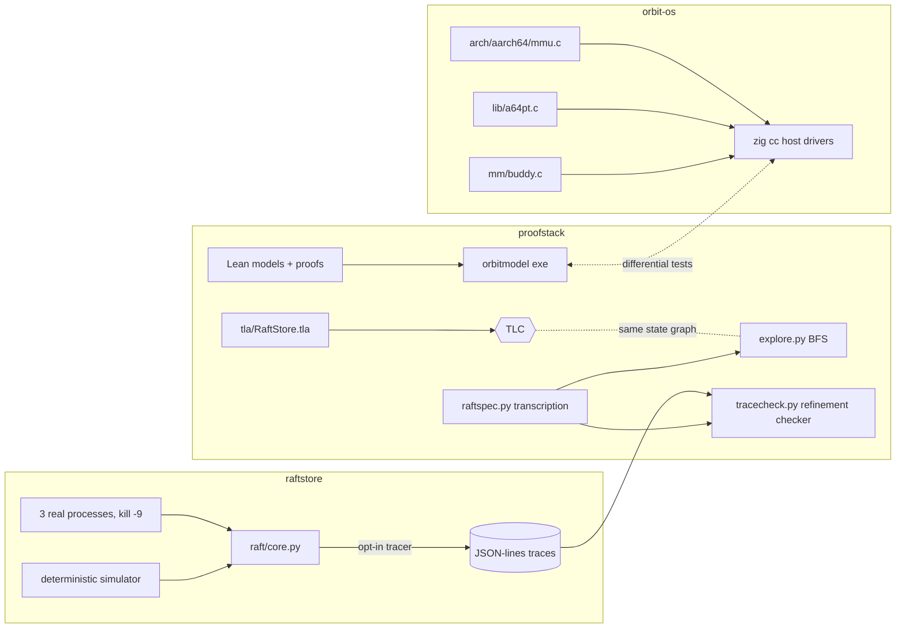

<p align="center">
  
</p>

<p align="center">
  <a href="https://github.com/coopersimpson101-debug/proofstack/actions/workflows/ci.yml"></a>
  <a href="https://github.com/coopersimpson101-debug/proofstack/releases/latest"></a>
  <a href="LICENSE"></a>
  
  
  
</p>

**Formal verification of two of my own systems:** a TLA+ specification of
[raftstore](https://github.com/coopersimpson101-debug/raftstore)'s Raft *as implemented*, model-checked
with TLC and validated against hundreds of real execution traces; and Lean 4 proofs of
[orbit-os](https://github.com/coopersimpson101-debug/orbit-os)'s buddy allocator and page-table code,
tied to the real C by differential and bounded exhaustive tests. Along the way it found two real
(latent) bugs in orbit-os, since fixed there.

<p align="center">
  <a href="#quickstart">Quickstart</a> ·
  <a href="#how-it-works">How it works</a> ·
  <a href="#results">Results</a> ·
  <a href="#bugs-found">Bugs found</a> ·
  <a href="docs/raft-spec.md">Raft spec notes</a> ·
  <a href="docs/lean.md">Lean notes</a>
</p>

<p align="center">
  
  <br>
  <sub>Every line is real output from this repository's scripts (Windows 10, Ryzen 5 3600, 2026-11-26),
  regenerated by <code>python scripts/make_figures.py</code> from <code>results/</code>.</sub>
</p>

## Highlights

- **A TLA+ spec of the Raft that raftstore actually runs**, not textbook Raft: PreVote, CheckQuorum
  leader stickiness, fast backtracking with the code's exact bisect semantics, the current-term commit
  rule, snapshots / InstallSnapshot, single-server membership changes, leadership transfer, ReadIndex,
  crash/restart with an un-fsynced commit index — eight safety invariants including linearizable reads.
- **TLC finds the bugs it should.** Switching on one deliberate bug at a time, TLC produces a
  13-state LeaderCompleteness counterexample for votes without the log check and reproduces the Raft
  paper's Figure-8 anomaly (35 states) once the leader no-op and the current-term rule are removed.
  (A third mutant — membership changes before the leader committed in its term — is *not* refuted at
  the bounds checked: 21.2 M states, no violation; the known anomaly needs a bigger model.)
- **The Python transcription is checked against the TLA+ spec**: on every cross-check model it reaches
  exactly the same states at the same BFS depths as TLC and generates the same transitions (up to one
  explained TLC double-count, see [docs/raft-spec.md](docs/raft-spec.md#model-checking)).
- **260 real traces refine the spec** — 240 from raftstore's deterministic simulator in six fault
  scenarios and 20 from real 3-process clusters whose leader is `kill -9`'d twice: 2,280,238 events,
  1,059,476 messages, 1,170 elections and 1,728 restarts, each checked field by field.
- **88 Lean theorems, 0 `sorry`**: the buddy allocator's invariant (alignment, no overlap,
  free + allocated = managed, complete coalescing) is preserved by init / add_range (of any range) / alloc / free,
  alloc-then-free restores the state; `map_range` maps exactly the intended pages (first mapping wins),
  and `mmu_init`'s identity map never makes kernel memory EL0-accessible.
- **Models tied to the C code**: orbit-os's `buddy.c`, `a64pt.c` and `mmu.c`, compiled with `zig cc`, agree with
  the verified Lean model on every output of thousands of random operations, and every 4 KiB page of
  the low 4 GiB, MMIO and higher-half windows of the real `mmu_init` is checked against the intended map.

## Status

| Part | Status |
|---|---|
| TLA+ spec of raftstore's Raft, 8 invariants | ✅ written, model-checked here |
| TLC, bounded exhaustive models (`xcheck-*`, `core3`, ...) | ✅ no violation at the bounds in [Results](#results) |
| TLC refutes deliberately broken variants (`mut-*`) | ✅ 2 of 3 refuted; ⏳ the membership mutant needs bigger bounds |
| Python transcription vs TLA+ (state-graph sizes) | ✅ same states, depths and transitions on all cross-check models |
| Trace export in raftstore (merged in `3a545c8`) | ✅ 194 raftstore tests pass |
| Trace validation: simulator + real processes | ✅ 260 / 260 traces |
| Lean: buddy allocator invariants, roundtrip | ✅ proved |
| Lean: page tables (`map_range`, separation, alias, W^X) | ✅ proved on the abstract descriptor model |
| Raw descriptor bits, table pool, real `mmu_init` | 🧪 tested (differential + bounded exhaustive), not proved |
| Liveness (eventual leader, progress) | ⏳ not specified |
| Lease reads (`read_only="lease"`) | ⏳ not modelled (timing) |
| On-hardware orbit-os check (TLB, real walker) | ⏳ see [Hardware validation](#hardware-validation--todo-for-the-author) |

## Quickstart

```sh
git clone https://github.com/coopersimpson101-debug/proofstack && cd proofstack   # next to raftstore/ and orbit-os/
pip install -e ".[test]" ziglang && python harness/build.py --orbit-os ../orbit-os
(cd lean && lake build)                                    # proofs + orbitmodel (needs elan)
TLA2TOOLS=/path/to/tla2tools.jar python scripts/run_tlc.py --xcheck mut-vote-any-log   # needs Java 11+
RAFTSTORE_DIR=../raftstore python -m pytest -q             # raftstore main (3a545c8 or later)
```

## How it works



### Raft: spec, model checking, trace validation

The spec ([`tla/RaftStore.tla`](tla/RaftStore.tla), notes in [docs/raft-spec.md](docs/raft-spec.md))
transcribes `raftstore/raft/core.py` method by method; each node operator is a pure function from the
node's state and one input to its new state plus the messages it sends, like `Raft.step()`. Timers
are abstracted to nondeterminism that covers every timing the code allows; the network drops,
duplicates and reorders; crash + restart keeps the persisted state and may roll the un-fsynced commit
index back. Invariants: Election Safety, Log Matching, Leader Completeness, State Machine Safety
(Ongaro & Ousterhout, *In Search of an Understandable Consensus Algorithm*, 2014, Fig. 3), linearizable
ReadIndex (Ongaro's dissertation, §6.4: every read returns an index ≥ the
highest index committed anywhere when the read started), the implementation's own assertions, and
"cached voters = configuration in the log".

Trace validation follows the idea of checking implementation traces against a TLA+ spec
(Cirstea, Kuppe, Loillier, Merz, Ron, *Validating Traces of Distributed Programs Against TLA+
Specifications*, 2024), but with **my own refinement checker in Python against a Python transcription
of the spec's actions** instead of TLC: for every traced call it enumerates the spec successors for
that node and input and requires one to reproduce the logged state, log, messages and reads exactly.
The transcription is tied to the TLA+ text by requiring identical reachable-state counts and depths
from TLC and from a Python BFS over the transcription.
Five deliberately broken raftstore variants are all rejected by the checker.

### orbit-os: Lean proofs and their link to the C code

The buddy model ([`lean/OrbitProofs/Buddy.lean`](lean/OrbitProofs/Buddy.lean)) keeps the C free
lists' order (one list filtered by order = `free[o]`), so the model returns the *same addresses* as
the C code. The invariant — aligned, in-bounds, pairwise disjoint blocks; counted free pages; no free
buddy pair at the same order; `managed = free + allocated` — is proved preserved by every operation.
Merging is the crux: a block of order `o` aligned to `2^o` has its buddy at `i ± 2^o` depending on
bit `o`, and the merged block `[min, min + 2^(o+1))` is exactly the union, so disjointness and the
counters carry over.

The page-table model ([`lean/OrbitProofs/Mmu.lean`](lean/OrbitProofs/Mmu.lean)) is a tree of total
functions over the 9-bit indices of a 48-bit VA (`L0 = va[47:39]`, …, `L3 = va[20:12]`); one theorem
per loop step of `map_range` (2 MiB block, skip under an existing block, or 4 KiB page) composes into
"`map_range` maps every previously unmapped page of the range to `pa + offset` and nothing else", and
a fold over `mmu_init`'s region list gives kernel/user separation. What is proved vs tested is listed
precisely in [docs/lean.md](docs/lean.md).

## Results

All measured on the development machine (Windows 10, Ryzen 5 3600 6C/12T, Java 21.0.13 Temurin,
tla2tools 1.7.4 / TLC 2.19, Lean 4.35.0), 2026-11-26. Raw TLC output: [`results/tlc/`](results/tlc).

**TLC** — breadth-first search (exhaustive at the stated bounds unless marked) and one random
simulation run; bounds and switches are defined in [`proofstack/models.py`](proofstack/models.py).
`xcheck-*` run with one worker (exact depth, compared with the Python explorer); the others use 10
workers, where TLC's reported depth is approximate. `features3` did not finish within its 40-minute
budget and is reported as incomplete.

<!-- TLC-TABLE -->
| model | bounds | mode | result | states generated | distinct states | depth | time (s) |
|---|---|---|---|---:|---:|---:|---:|
| `xcheck-core` | 2 srv, term≤2, log≤3, msgs≤2, writes≤1 | BFS | no violation, complete | 308,603 | 39,962 | 23 | 23 |
| `xcheck-reads` | 2 srv, term≤2, log≤3, msgs≤2, writes≤1, reads≤1, transfers≤1 | BFS | no violation, complete | 4,552,999 | 491,330 | 27 | 208 |
| `xcheck-snapshots` | 2 srv, term≤2, log≤3, msgs≤2, writes≤2, crashes≤1, compactions≤1, LossyCommit | BFS | no violation, complete | 9,026,505 | 975,216 | 25 | 462 |
| `xcheck-membership` | 3 srv (2 voters), term≤2, log≤4, msgs≤2, writes≤1, conf changes≤1 | BFS | no violation, complete | 2,685,035 | 323,846 | 38 | 140 |
| `core3` | 3 srv, term≤3, log≤3, msgs≤2, writes≤1, crashes≤1, symmetry | BFS | no violation, complete | 143,293,033 | 15,632,316 | 61 | 2190 |
| `features3` | 3 srv, term≤3, log≤3, msgs≤2, writes≤1, reads≤1, transfers≤1, compactions≤1, symmetry | BFS | stopped (time limit), no violation so far | 218,150,463 | ≥ 26,380,031 (incomplete) | — | 2401 |
| `sim-all3` | 3 srv, term≤5, log≤6, msgs≤6, writes≤3, crashes≤2, reads≤2, transfers≤2, compactions≤2, LossyCommit | simulation, 20,000 behaviours ≤ depth 100 | no violation | 9,898,182 | — | — | 60 |
| `mut-vote-any-log` | 3 srv, term≤3, log≤3, msgs≤2, writes≤1, MutVoteAnyLog, no PreVote, no CheckQuorum, symmetry | BFS (stops at counterexample) | **LeaderCompleteness violated** (13-state trace) | 9,543 | 2,152 | 14 | 3 |
| `mut-figure8` | 3 srv, term≤5, log≤2, msgs≤2, writes≤2, UnsafeCommitAnyTerm, MutNoNoop, no PreVote, no CheckQuorum, symmetry | BFS (stops at counterexample) | **LeaderCompleteness violated** (35-state trace) | 21,746,378 | 3,614,464 | 37 | 305 |
| `mut-membership` | 4 srv (3 voters), term≤3, log≤4, msgs≤2, conf changes≤2, SkipTermStartCheck, no PreVote, no CheckQuorum | BFS (stops at counterexample) | **not refuted**: no violation, complete | 173,586,904 | 21,185,127 | 43 | 2016 |
<!-- /TLC-TABLE -->

**Trace validation** ([`results/tracecheck.json`](results/tracecheck.json)): 260 / 260 traces refine
the spec.

<!-- TRACE-TABLE -->
| source | traces (ok) | events | messages | elections | restarts (torn batch) | reads released | conf changes | transfers |
|---|---:|---:|---:|---:|---:|---:|---:|---:|
| simulator: everything at once | 40 (40) | 383,955 | 171,805 | 210 | 333 (57) | 3,288 | 330 | 173 |
| simulator: 5 nodes + leadership transfer | 40 (40) | 423,986 | 202,779 | 135 | 244 (0) | 2,417 | 0 | 234 |
| simulator: lossy net + crashes + partitions | 40 (40) | 331,167 | 151,907 | 138 | 247 (0) | 5,815 | 0 | 0 |
| simulator: membership changes | 40 (40) | 405,481 | 178,056 | 254 | 231 (0) | 3,551 | 385 | 240 |
| simulator: no PreVote / no CheckQuorum | 40 (40) | 312,272 | 141,373 | 185 | 222 (0) | 5,438 | 0 | 0 |
| simulator: real WAL on faulty disk + drive pulls | 40 (40) | 294,478 | 133,926 | 188 | 411 (101) | 5,250 | 0 | 0 |
| real 3-process clusters, leader `kill -9` ×2 | 20 (20) | 128,899 | 79,630 | 60 | 40 (3) | 3,754 | 0 | 0 |
| **total** | **260 (260)** | **2,280,238** | **1,059,476** | **1,170** | **1,728 (161)** | **29,513** | **715** | **647** |

<sub>Windows AMD64, 12 logical CPUs, 2026-11-26; validation took 49 s with 6 processes.</sub>
<!-- /TRACE-TABLE -->

**Lean:** 88 theorems (58 buddy, 30 page tables), `lake build` with no `sorry`; axioms of the
headline theorems in [`results/lean_axioms.txt`](results/lean_axioms.txt).

**Differential and bounded tests against the C code** (`tests/`): buddy — 300 random sessions ×
200 operations plus 40 alloc/free-everything sessions, every return value and all counters
identical; page tables — 100 random `map_range` sessions (aligned and unaligned, block-sized and
page-sized) with every translation query at every range boundary ±1 page and at random addresses
identical, and `mmu_init` on the two board layouts (RAM reduced to 32 MiB for the model); `mmu_init` — for the qemu-virt and Pi 5
layouts and 25 random layouts, every 4 KiB page of the low 4 GiB, the MMIO window and both TTBR1
windows (2.1 M pages for qemu-virt) equals the intended mapping.

## Bugs found

Both orbit-os bugs were found on orbit-os `ba8bac1` and are fixed in orbit-os
[`1a8385b`](https://github.com/coopersimpson101-debug/orbit-os/commit/1a8385b07ccd95ecef07be80a916c75073fb171e)
(branch `fix/buddy-overlap-map-range`), which proofstack now pins. The Lean model keeps the original
algorithms (`addRangeV1`, `mapRangeV1`) and the theorems that exhibit the bugs; with the fix,
`Buddy.addRange_inv` holds for every range, without the non-overlap hypothesis it needed before.

| where | what | severity | evidence |
|---|---|---|---|
| orbit-os `buddy_add_range` | an add that starts inside an existing free block re-inserts its pages: 5 free pages in a 4-page span, `buddy_check()` still 0, page 1 handed out twice; random overlapping adds crash the C allocator | latent: `mm_init` only adds disjoint holes; **fixed** in orbit-os `1a8385b` | `Buddy.bug_*` theorems (on `addRangeV1`); regression: `Buddy.fixed_*`, `test_overlapping_add_range_fixed` |
| orbit-os `map_range` | end computed as `ALIGN_DOWN(va) + ALIGN_UP(size)`: an unaligned range loses its last page; `mmu_init` passes the DTB unaligned | latent: the DTB lies inside mapped RAM on both boards; **fixed** in orbit-os `1a8385b` | `Mmu.unaligned_bug` (on `mapRangeV1`); regression: `Mmu.unaligned_fixed`, `test_unaligned_dtb_outside_ram_is_fully_mapped` |
| raftstore restart | a crash while one Ready batch is being written leaves only a prefix of it in the WAL | safe (acks are sent after `save()`), but outside the spec's Restart; first found as 10 rejected traces | [docs/raft-spec.md](docs/raft-spec.md#finding-a-crash-in-the-middle-of-persisting-one-ready-batch-leaves-a-torn-suffix) |
| raftstore commit rule | the §5.4.2 current-term rule is almost redundant: the leader no-op plus "send everything up to the end" means acks never stop at an old-term index except under the 64-entry message cap | observation | [docs/raft-spec.md](docs/raft-spec.md#finding-the-current-term-commit-rule-is-almost-redundant-in-raftstore) |

TLC found **no counterexample** in raftstore's real protocol at the bounds checked. The bugs were
reported, not fixed: orbit-os is owned by another workstream, and the raftstore behaviour is safe.

## Hardware validation / TODO for the author

The proofs are about the C code's logic; they assume the Arm stage-1 walk works as the architecture
specifies. To close the loop on real hardware (⏳):

```sh
# orbit-os on a Raspberry Pi 5 (or qemu-system-aarch64 -M virt): after mmu_init, translate with AT S1E1R
# and compare with the model, e.g. from the shell: `mmu check` (to be added to orbit-os) for every page of
# the kernel image, the user sections, the UART and the GIC
```

| board | pages checked with `AT S1E1R` | mismatches vs `orbitmodel mmu` | EL0 access to kernel pages faults |
|---|---|---|---|
| Raspberry Pi 5 | | | |
| qemu-virt (on a Linux host) | | | |

## Roadmap

- Liveness under fairness (eventual leader election with a stable network) and a refinement mapping
  from the spec to a single-copy linearizable KV store.
- Trace validation directly in TLC (trace spec + `-dump`) as a second, independent checker.
- Prove the raw descriptor encoding (`pa | prot | VALID | TABLE`) with `bv_decide` and lift the table
  pool into the model; prove `kheap.c` on top of the buddy model.
- Upstream the two orbit-os fixes and add regression tests there.

Downloaded tools (official sources only): Eclipse Temurin JDK 21 (api.adoptium.net), `tla2tools.jar`
v1.7.4 (github.com/tlaplus/tlaplus releases), elan 4.4.0 and Lean 4.35.0 (github.com/leanprover/elan,
releases.lean-lang.org), `ziglang` (PyPI), `@resvg/resvg-js` (npm, banner PNG only).

MIT licensed — see [LICENSE](LICENSE).
